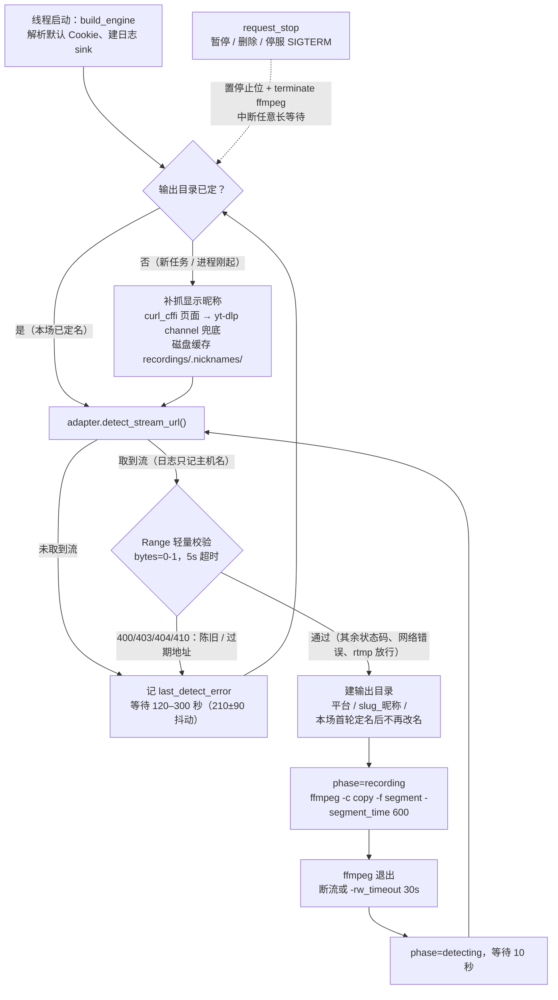
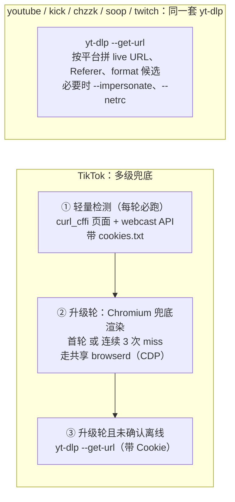
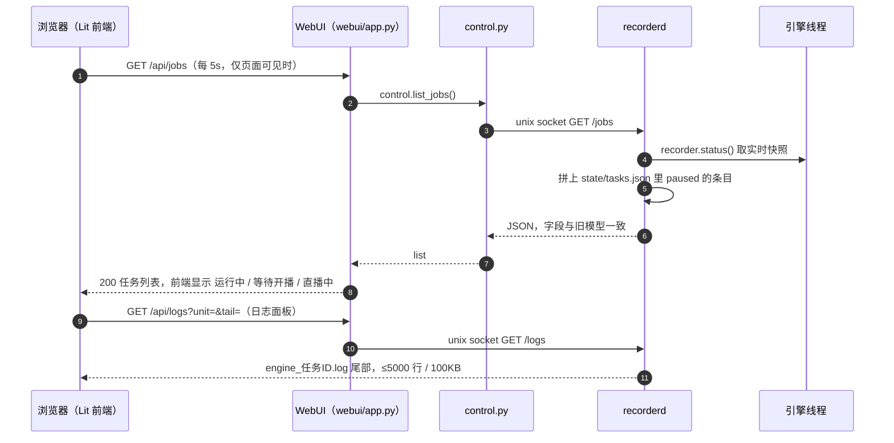
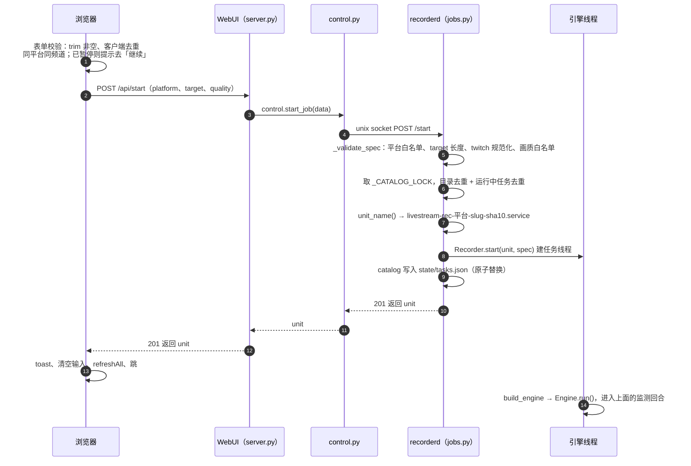

# 项目结构

本项目按平台和用途组织代码，根目录只保留项目入口、说明和跨平台脚本。

## 统一录制引擎（核心）

所有平台的无人值守录制统一由 Python 引擎实现，平台差异收敛为"适配器"：

```text
scripts/
├── dlr.py                 # 引擎入口：python3 scripts/dlr.py <platform> <target> [选项]
├── browserd.py            # 共享常驻 Chromium 渲染服务（所有引擎复用，CDP over pipe）
└── dlr/
    ├── engine.py          # 统一录制循环：输出布局、检测、ffmpeg 分段、优雅停止、断流重试
    └── adapters/
        ├── base.py        # 适配器接口 + 频道标识提取
        ├── ytdlp.py       # youtube / kick / chzzk / soop / twitch（yt-dlp 通用，含 impersonate 兜底）
        ├── youtube_nsig.py  # YouTube HLS `n` 校验：走 yt-dlp 的 EJS provider（依赖 Node + yt-dlp-ejs）
        ├── youtube_browser.mjs  # YouTube 浏览器兜底（配合 youtube_nsig 解出可访问的 HLS）
        ├── tiktok.py      # TikTok：轻量检测每轮先行（带 Cookie），升级轮才跑 yt-dlp 与浏览器
        └── tiktok_extract.py  # TikTok 取流（curl_cffi 页面 + webcast API；渲染走 browserd）
```

每平台的 `record.sh` 最终都 `exec` 到引擎（引擎宿主 `webui/recorderd.py` 不经此包装、直接构造引擎；包装保留给命令行手动使用）：

```bash
exec python3 "${SCRIPT_DIR}/../../scripts/dlr.py" <platform> "$@"
```

其中 `tiktok/record.sh` 另做两件命令行便利的事：补 `PYTHONPATH`/`PATH` 让子进程
`yt-dlp` 能找到 `~/.local` 的 `curl_cffi`，以及在未显式指定时自动附带项目根
`cookies.txt`（见下文「登录 Cookie」）。

支持平台：`youtube kick chzzk soop tiktok twitch`。Twitch 本地录制使用
`platforms/twitch/record.sh`，转推 Bilibili 使用 `platforms/twitch/twitch.sh`。

## 平台目录

平台相关脚本统一收在 `platforms/` 下，根目录不再按平台平铺：

```text
├── platforms/
│   ├── tiktok/             # record.sh 转发入口
│   ├── soop/               # record.sh 入口
│   ├── youtube/            # record.sh 入口
│   ├── kick/               # record.sh 入口
│   ├── chzzk/              # record.sh 入口
│   └── twitch/             # record.sh 本地录制入口 + twitch.sh 转推 Bilibili
├── bili/                  # Bilibili 推流 + 稿件投稿（开播/推流/轮播/值守/upload.py + 独立 WebUI 与 user 单元，见 bili/README.md）
├── scripts/               # 统一录制引擎（见上）
├── systemd/               # WebUI/browserd systemd unit 与安装脚本
├── tests/                 # WebUI 与引擎单元测试（bili/ 另有 bili/tests/，由 test.sh 一并运行）
├── webui/                 # 本地录制任务管理页面与 API（app.py 与前端源码 frontend/、vendor/）
├── docs/                  # 使用、配置、排障和维护文档（archive/ 存已归档的历史排障记录）
├── archive/               # 已封存的根目录散脚本（start.sh / yt.sh，见 archive/README.md）
└── test.sh                # 运行仓库全部单元测试（tests/ + bili/tests/，纯标准库）
```

根目录只保留说明、测试入口和上表列出的目录。历史散脚本（`start.sh` 取流检测、
`yt.sh` YouTube 转推）已移入 `archive/`，功能由 `platforms/` 与 `bili/` 覆盖。

## 运行产物

录制输出统一到 `RECORDINGS_DIR`（systemd 环境默认 `/home/ubuntu/tiktok/recordings`，
手动运行默认 `./recordings`），按平台分目录，平台下按 `{channel}[_{nickname}]/` 建频道目录：
每个频道只会出现一个目录——昵称在目录确定前每轮补抓（进程重启后从首轮
重新抓，不依赖内存记忆），直到开播首轮仍无昵称才回退为纯 `{channel}/`；
且目录名在本场录制首轮确定后固定，不会中途改名分裂。

```text
recordings/
├── tiktok/
│   ├── emiri.okazaki/          # 昵称抓取失败时的退化命名
│   └── emiri.okazaki_エミリ/    # 正常命名（每个频道二选一，不会同时存在）
├── soop/
│   └── playerid_Nickname/
├── youtube/
│   └── ChannelName/
└── logs/                      # 日志（按平台分目录）
    ├── tiktok/
    │   ├── ffmpeg_record_emiri.okazaki_20260823.log   # ffmpeg 自身日志
    │   └── engine_livestream-rec-tiktok-emiri.okazaki.log  # 引擎日志（WebUI 任务）
    ├── soop/
    └── youtube/
```

分段文件名 `{channel}[_{nickname}]_%Y%m%d_%H%M%S.mp4`，不含平台前缀（平台已在目录层级体现）。

WebUI 的最近文件列表扫描 `RECORDINGS_DIR`，不会遍历整个仓库。仓库已忽略
`recordings/`、`logs/`、`*.mp4` 等运行产物。

**目录自愈**：录制引擎会对输出目录做健壮性保护——每次录制回合启动前以及整个
录制期间都会确认输出目录存在；即使目录（含父目录，如整块 `recordings/`）被外部
删除/清理，也会在 ffmpeg 写下一个分段前自动重建，不影响持续录制。因此空目录、
占位目录可以直接删除，无需保留。

## 控制面

录制执行拆成**两个进程**（见 [ADR 0002](adr/0002-recorderd-split.md)）：

```text
livestream-recorderd.service   webui/recorderd.py
  引擎宿主：每个任务是一个引擎线程（webui/recorder.py 驱动 scripts/dlr/engine.py 的
  Engine）；独占任务目录 state/tasks.json；控制面只监听本地 unix socket
  （默认 state/run/recorderd.sock，0700 目录 / 0600 socket，可用 RECORDERD_SOCKET 覆盖）

livestream-webui.service       webui/app.py
  静态资源 + /api/* 编解码；任务状态与控制经 webui/control.py 转发给 recorderd；
  录制文件（列表/下载/删除）与系统概览是本进程的文件系统视图
```

因此**重启 WebUI 不再打断录制**（改前端、调端口、升级 UI 都不影响引擎）；反之重启
recorderd 会按任务目录恢复全部未暂停任务。WebUI 不再按频道创建 systemd 单元，也不经
`record.sh` 包装（包装仅保留给命令行手动使用）。

后端实现拆分为 `webui/{config,jobs,files,stats,server,recorder,control,recorderd}.py`
（配置 / 任务编排与任务目录 / 录制文件 / 概览聚合 / WebUI HTTP 层 / 引擎线程调度 /
控制面客户端 / 控制面服务）；`app.py` 仅为兼容门面与 WebUI 直接执行入口；跨模块配置
一律经 `config.X` 运行时读取，便于测试在定义处 patch。

前端是**原生 Web Components（Lit 3）**，没有构建链：`webui/index.html` 只是静态壳
（引导脚本注入 import map + 加载入口模块），源码在 `webui/frontend/`（`components/`、
`views/`、`stores/`、`services/`、`config/`、`actions/`）。lit@3 默认从 CDN（esm.sh）
加载，离线/不可达时回落到仓库内 `webui/vendor/`（最小闭包）。
`webui/server.py` 把 `/frontend/` 与 `/vendor/` 作为静态资源提供（限白名单后缀并强制
目录边界），见 [ADR 0001](adr/0001-webui-frontend-lit.md)。

生命周期语义与旧多进程模型一一对等：

- **优雅停止**：暂停/删除/停服都会对每个引擎 `request_stop()`——置停止位、中断长等待
  （检测间隔可长达 5 分钟）、立即向 ffmpeg 发终止信号收尾当前分段。控制类操作（暂停/
  删除/重启）短 join 最长 5 秒：引擎若正阻在网络调用（页面抓取超时可达 20s）里，超时
  即返回、线程后台自行退出并从任务表自摘，API 不挂起；recorderd 停服（SIGTERM/SIGINT）
  则并行 join 全部引擎（代码上限 45s，单元 `TimeoutStopSec=75s` 兜底）。命令行路径
  （dlr.py）仍由引擎信号处理器直接 `os._exit`，停止不会等到超时才生效。
- **崩溃自动重启**：引擎线程内未捕获异常按 10 秒退避重建（等价旧
  `Restart=on-failure RestartSec=10s`），重启计数即任务状态里的 `restarts`。
- **状态**：`active/running`（检测或录制中）、`active/activating`（构建/退避窗口）、
  `active/deactivating`（停止收尾）、`failed`、`paused`；`live` 由引擎
  `phase == recording 且 ffmpeg 存活` 直接判定，不再扫描 /proc 进程树。
  状态里的 `pid`/`memory` 描述**引擎宿主进程**（线程与进程共享 RSS，无法按任务切分）。

**任务目录（`state/tasks.json`）**：仍是期望状态与参数持久化——创建任务时写入启动
参数（平台/频道/画质/Cookie），「暂停」置 `paused=true`（参数留存、线程停止），
「继续」按记录重建线程，「删除」清理记录。**只有 recorderd 读写它**（单一写者）：
recorderd 启动时把目录作为期望状态恢复所有未暂停任务，因此它重启后任务会恢复；已暂停
任务不会自动启动。单个任务恢复失败只写入服务日志，不会删除其目录记录或阻止服务启动。
目录读取失败或损坏时按空目录处理，不影响其他功能。`livestream-rec-*.service` 命名仅作为
稳定任务 ID 沿用（目录键、日志文件名、API 字段），历史数据零迁移。**列表接口** = 运行
任务的状态快照（`recorder.status()`）拼上目录里 `paused:true` 的条目，两者字段形状一致
（前端零改动）；因此暂停任务重启后仍显示，运行任务的状态永远来自真实线程而非缓存。
文件为运行产物（已 gitignore），路径可用 `WEBUI_STATE_DIR`/`STATE_DIRECTORY` 覆盖；
两个服务单元都通过 `ReadWritePaths=.../state` 放行写入（WebUI 侧是为连接 socket）。

**控制面不可达时的降级**：recorderd 宕机不影响 WebUI 启动与静态资源；`/api/jobs`、
`/api/overview`、`/api/logs` 与控制类 POST 返回 **503**，`/api/files` 照常可用，
`/api/health` 返回 `{"ok": true, "recorderd": false}` 便于排障。前端据此显示
「部分数据同步失败 + 重试」。

**任务日志**：每个引擎的输出写入 `recordings/logs/<平台>/engine_<任务ID>.log`
（WebUI 日志面板经控制面读取，尾部上限 5000 行/100KB），同时带 `[平台:频道]` 前缀镜像到
recorderd 的 stdout（`journalctl -u livestream-recorderd -f` 可整体回看）；ffmpeg 自身
日志仍按 `ffmpeg_record_*.log` 分文件。

**运行用户**：`livestream-webui.service` 以 `ubuntu` 运行（与 browserd 一致），
原生使用其 `~/.local` 下的 yt-dlp / curl_cffi；换用户运行时需自行保证依赖可见。
旧版每频道单元靠 `platforms/tiktok/record.sh` 等包装桥接 `PYTHONPATH`/`PATH`，该兜底仅对命令行
入口保留。

**共享浏览器（`tiktok-browserd.service`）**：TikTok 检测的浏览器兜底统一走
`scripts/dlr/browserd.py`（`127.0.0.1:9555`，`TIKTOK_BROWSERD_URL` 可覆盖）：
一个常驻 Chromium 通过 CDP（`--remote-debugging-pipe`）为所有引擎开标签页渲染，
替代每轮冷启动浏览器（曾 ~247 次/小时、≈0.5 核 CPU）。由 `systemd/install.sh`
安装并启用；服务不可用时引擎自动跳过浏览器兜底，轻量检测与 yt-dlp 路径不受影响。

**登录 Cookie**：TikTok 部分主播要求登录态才能拿到直播流（无 Cookie 时
yt-dlp / Web API 均判“未开播”）。`platforms/tiktok/record.sh` 会检测项目根 `cookies.txt`
（Netscape 格式，已被 `.gitignore` 忽略），存在时自动附带 `--cookies` 给引擎，
由适配器透传给 yt-dlp；Cookie 与 Bilibili 推流码等敏感信息不要提交仓库。

## 流程

以下 Mermaid 图在 GitHub 上直接渲染；纯文本查看时以上下文说明为准。

### 录制监测：引擎侧回合循环

`Engine.run()`（`scripts/dlr/engine.py`）是一个 `while not stopping` 的回合循环：
「取流 → 校验 → 录制」，取不到就带抖动等下一轮。每个任务是 recorderd 进程内的一个
线程（详见 [ADR 0002](adr/0002-recorderd-split.md)）。



- 每回合都包在 `try/except` 里：单次异常只记日志并等一轮，不会压垮监控循环。
- 录制期间看护线程 `_watch_dir()` 会在输出目录被外部删除时自动重建（目录自愈）。
- `phase` → UI 状态的映射见上文「生命周期语义」；检测间隔天然是分钟级，UI 的 5 秒轮询
  只读状态、不触发检测。

### 录制监测：各平台取流顺序



日志里对应 `[tiktok_detect] stage=page|browser|ytdlp …` 的分阶段诊断。

### 状态观测：UI 每 5 秒读一次



控制面不可达时 `/api/jobs`、`/api/overview`、`/api/logs` 返回 503，`/api/files` 照常；
`/api/health` 给出 `"recorderd": true|false`。

### 新增录制任务



关键点：

- **单一写者**：`state/tasks.json` 只由 recorderd 读写，WebUI 从不碰目录格式。
- **两层去重**：前端做即时提示（体验），控制面做权威校验（正确性）。
- **错误映射**：控制面 4xx → `RuntimeError` → WebUI 400（前端直接显示服务端文案）；
  控制面不可达 → `ControlUnavailable` → WebUI 503（前端按「部分数据同步失败」降级）。
- **持久化即期望状态**：recorderd 重启会把目录里所有非 paused 任务重新拉起；
  暂停/继续/重启/删除复用同一控制面，删除只删记录、不删录像文件。
